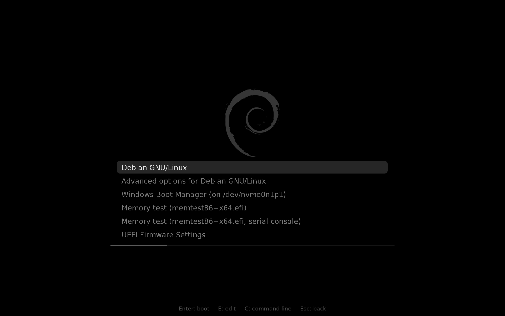
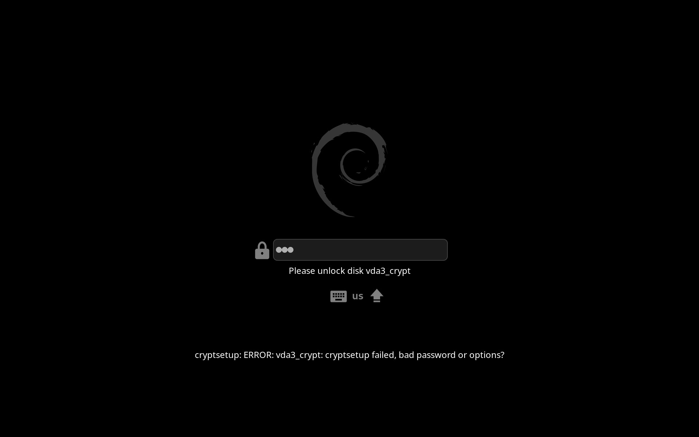
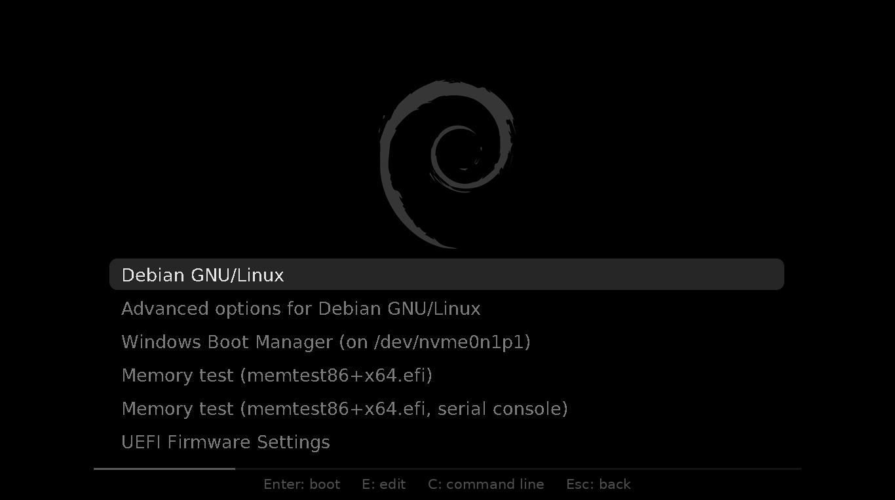
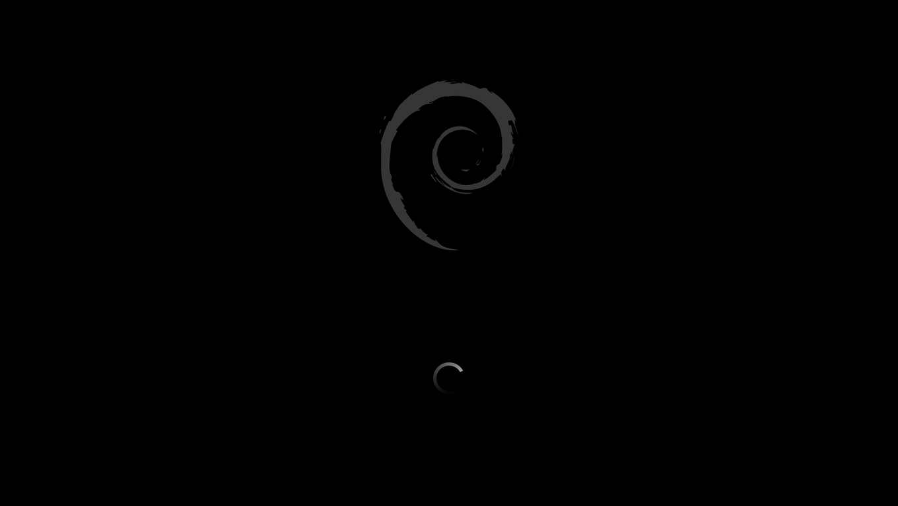

# debian-dark-boot

A dark boot screen for Debian 13 (trixie):

- **GRUB:** a black screen, a grey Debian logo, the menu under it and a
  thin countdown line.
- **Plymouth:** the same logo at the same pixels, a small spinner, and a
  dark password box when the disk is encrypted.

No text shows between the menu and the login screen. Press Esc during the
splash to see the boot messages.

| | |
| --- | --- |
|  |  |
|  |  |

The tests make screenshots at more sizes, of the submenu, the editor and
real boots in a VM. See `test/README.md`.

## Requirements

- Debian 13. Use `--force` to try another version.
- GRUB (`grub-efi` or `grub-pc`) and initramfs-tools. dracut is not
  supported.
- A screen at least 768 pixels high.
- If Plymouth is missing, the script installs `plymouth`,
  `plymouth-themes` and `plymouth-label` with apt.

Disk encryption (LUKS) is optional. The script finds it by itself.

## Install and uninstall

```
./install.sh --dry-run     # show the plan, change nothing
sudo ./install.sh          # install, asks once
sudo ./install.sh --status # check every part
sudo ./uninstall.sh        # undo everything
```

Other options: `--yes` (do not ask), `--force` (not Debian 13) and, for
`uninstall.sh`, `--keep-packages`. Both scripts rebuild the initramfs and
`grub.cfg`. Reboot to see the result. You can run `install.sh` again at any
time. It puts back only what is missing.

`uninstall.sh` removes every file, edit and package that `install.sh`
added. Tests compare `/etc`, `grub.cfg` and the initramfs before and after.

## What it changes

| Path | Change |
| --- | --- |
| `/boot/grub/themes/debian-dark/` | New. The GRUB theme. |
| `/etc/default/grub.d/debian-dark.cfg` | New. Theme, visible menu, video mode, splash options. |
| `/etc/grub.d/10_linux` | Two small edits, see below. |
| `/usr/share/plymouth/themes/debian-dark/` | New. The Plymouth theme. |
| `/etc/plymouth/plymouthd.conf` | `Theme=debian-dark`, `DeviceScale=1`. |
| `/etc/initramfs-tools/hooks/debian-dark-*` | New. Grey logo and fonts in the initramfs. Hides "set up successfully" after the password. |
| `/etc/initramfs-tools/modules` | Adds the graphics driver, so the splash starts early. |
| `/etc/issue.d/vt-cursor.issue` | New. Turns the cursor on again at text logins. |
| `/etc/apt/apt.conf.d/99debian-dark-boot` | New. Warns when an upgrade removed the `10_linux` edits. |

The main "Debian GNU/Linux" entry gets `splash vt.global_cursor_default=0
loglevel=3` and stops printing "Loading Linux". The "Advanced options"
entries stay stock. `GRUB_TIMEOUT` is not changed.

The script adds the driver of each graphics card that has a screen, for
example `i915` or `amdgpu`. A privacy screen driver such as
`thinkpad_acpi` is added too, because the graphics driver waits for it.
The NVIDIA driver from NVIDIA is never added.

Each run that changes something saves the old files in
`/var/backups/debian-dark-boot/<date>-install`. The new `grub.cfg` and
initramfs are checked before use. If a step fails, the script stops and
prints how to undo.

## Boot without the splash

Choose the first kernel in "Advanced options". Or press `e` on the main
entry, delete `splash` and press Ctrl-x.

## Known limits

- The screen is black for one or two seconds while the kernel starts.
  Debian kernels do not have `CONFIG_FRAMEBUFFER_CONSOLE_DEFERRED_TAKEOVER`,
  which removes this gap.
- GRUB cannot scale, so the theme has one size. It fits screens from
  1366x768 to about 2560x1600. On 4K it is small but sharp.
- On screens lower than 976 pixels, the GRUB editor, the command line and
  the moment after you choose an entry cover part of the logo.
- Plymouth draws the same pixel size on every screen. A dense second
  screen shows a smaller splash.
- With LUKS and a keyboard layout other than `us`, set `KEYMAP=y` in
  `/etc/initramfs-tools/initramfs.conf`. The script warns about this.
- An upgrade of grub-common can replace `10_linux`. The next boot then
  shows text, and the apt hook prints a warning. Run `sudo ./install.sh`
  again.
- `install.sh` takes over theme files from an earlier install by hand.
  `uninstall.sh` then removes them too.

## Make the themes again

The files in `themes/` come from `src/make-assets.py`. You need it only to
change the size or the look. Edit the values at the top, then run:

```
podman build -t localhost/ddboot-tools:latest -f test/Containerfile.tools test
src/make-assets.sh
```

## Tests

The tests install Debian in a VM, with and without LUKS, and check the
install, a grub-common upgrade and the uninstall. They run without root,
in podman with QEMU. See `test/README.md`.

## Credits

- Debian logo: desktop-base, Debian Open Use Logo License.
- GRUB fonts: DejaVu Sans and DejaVu Sans Mono (Bitstream Vera and DejaVu
  license).
- Keyboard layout names (`keymap-render.png`): Plymouth spinner theme
  (GPL 2 or later).
